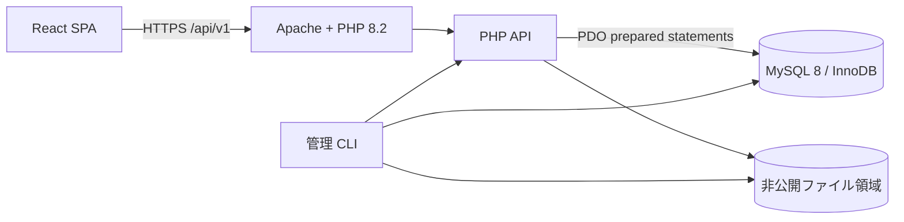
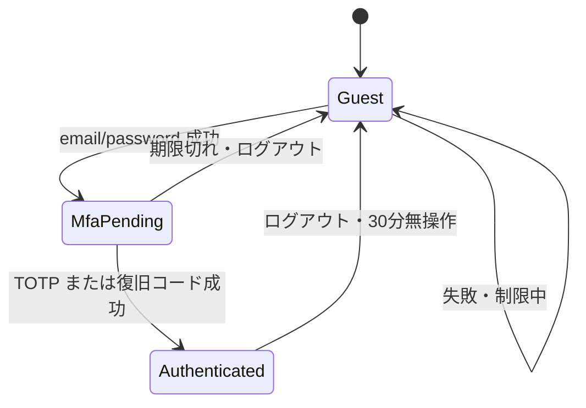
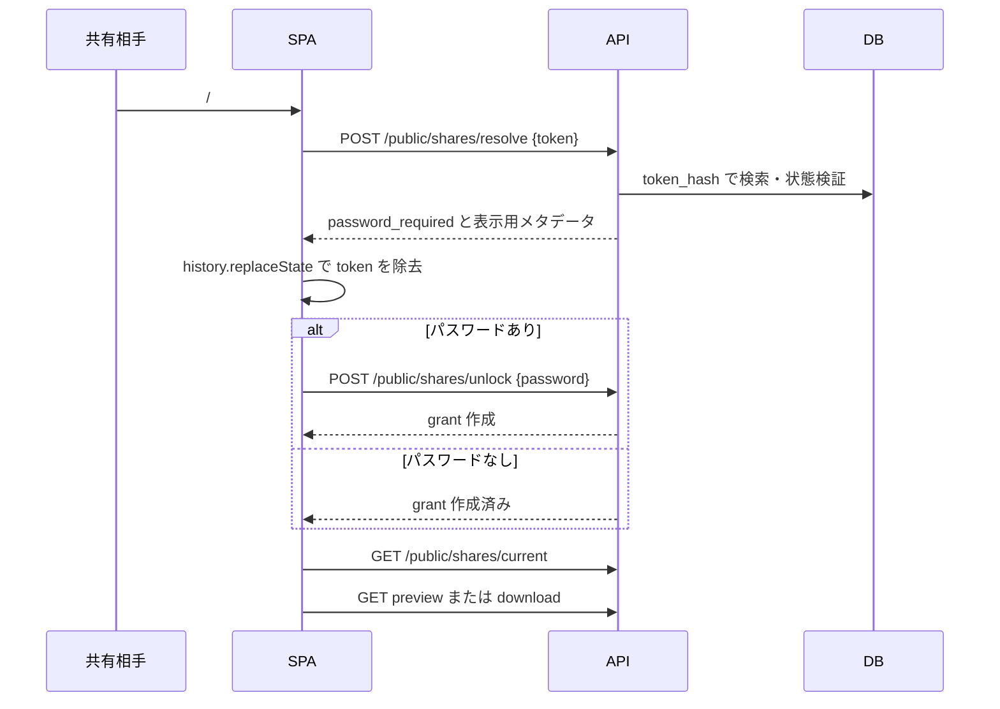

# アーキテクチャ設計

## 1. システム構成

- `frontend/`: React、TypeScript、Vite、React Router、CSS Modules。
- `backend/public/index.php`: API の唯一の HTTP エントリーポイント。
- `backend/src/`: PSR-4 でロードするアプリケーションコード。
- `backend/database/migrations/`: 順序付き SQL マイグレーション。
- `backend/bin/`: マイグレーション、管理者作成、履歴清掃、隔離ファイル清掃、バックアップ CLI。
- `var/storage/`: 非公開ファイル。公開ディレクトリ外に配置する。
- API と SPA は同一オリジンで提供し、CORS は有効にしない。開発時だけ Vite の `/api` プロキシを使う。

## 2. HTTP とレスポンス規約

- API prefix は `/api/v1`。
- JSON 成功レスポンスは `{"data": ..., "meta": ...}`、エラーは `{"error":{"code":"...","message":"...","details":...}}`。
- JSON の `Content-Type` は `application/json; charset=utf-8`。
- リスト API は `page`（1 始まり）と `per_page`（既定 25、最大 100）を使う。
- エラーコードは機械判定用の英大文字スネークケースとし、表示文はフロントエンドが日本語へ対応付ける。
- 状態変更 API は `X-CSRF-Token` を必須とする。トークンは各セッションに保持し、ログイン状態変更時にローテーションする。

## 3. 管理者認証

- 管理 Cookie 名は `SECURESHARE_ADMIN`。`Secure`、`HttpOnly`、`SameSite=Lax`、Path `/api/v1`。
- パスワード成功時と MFA 成功時にセッション ID を再生成する。
- `mfa_pending` は 5 分で失効し、その間は MFA API とログアウトだけを許可する。
- 完全認証は無操作 30 分で失効する。各認証済み API 成功時に最終利用日時を更新する。
- ログイン失敗は、同一 IP または正規化メールアドレスのいずれかが 15 分以内に 5 回へ達した場合、15 分間拒否する。成功時に対象の未失効失敗履歴を無効化する。
- 復旧コードは 10 個生成し、一度だけ表示する。使用時はトランザクション内でロックし、`used_at` を設定する。

## 4. 公開共有フロー

共有 URL は `https://example.jp/#/s/{token}`。token は `random_bytes(32)` の base64url 表現で、DB には `SHA-256(token)` だけを保存する。

- 匿名 Cookie 名は `SECURESHARE_PUBLIC`。管理 Cookie とセッション保存領域を論理分離する。
- resolve 後、匿名セッションには `share_id` と `unlocked` を保持し、生 token は保持しない。
- 匿名 grant は無操作 30 分、または共有期限の早い方で失効する。
- パスワード失敗は share ID と IP ごとに 15 分以内 5 回で 15 分間拒否する。生 token はログへ書かない。

## 5. ファイル処理

### アップロード

1. PHP のアップロードエラーと `Content-Length` を確認する。
2. 一時ファイルの実サイズが 20 MiB 以下であることを確認する。
3. ファイル名を Unicode 正規化し、制御文字、パス区切り、末尾ドットを除去して 255 bytes 以下にする。
4. `finfo` と形式別検証を行う。
5. SHA-256 を計算する。
6. `users` 行を `FOR UPDATE` でロックし、`SUM(files.size_bytes)` と追加サイズが 1 GiB 以下か確認する。
7. 非公開領域の一時名へ移動し、ランダムな保存キーへ rename する。
8. `files` 行を挿入して commit する。DB 失敗時は保存ファイルを削除する。

形式別検証:

- JPEG/PNG/WebP: `finfo`、拡張子、`getimagesize()` の形式が一致する。
- PDF: `application/pdf`、`.pdf`、先頭 `%PDF-` が一致する。
- TXT: `.txt`、NUL byte なし、UTF-8 として妥当。MIME は `text/plain` を許可する。
- ZIP: ZIP signature と central directory を検査し、暗号化、絶対パス、`..`、NUL、10,000 entries 超過を拒否する。展開はしない。
- DOCX/XLSX: ZIP 検査に加え `[Content_Types].xml` と `word/` または `xl/` の必須 entry を確認する。マクロ有効形式は拒否する。

### 削除

1. 所有者と対象を検証し、ファイル行をロックする。
2. 実体を同一ファイルシステム内の `.trash/{storage_key}` へ rename する。
3. ファイル行を削除する。共有は cascade 削除し、アクセス履歴の外部キーは `SET NULL` とする。
4. commit 後に隔離実体を unlink する。unlink 失敗は構造化ログへ残し、清掃 CLI が再試行する。
5. DB 処理失敗時は元の保存場所へ rename して復元する。

## 6. ダウンロード排他制御

1. トランザクションを開始し、`shares` を `FOR UPDATE` で取得する。
2. 停止、期限、匿名 grant、パスワード解除、回数上限を再検証する。
3. 有限の場合は `download_count` を 1 増加し、成功履歴を挿入して commit する。
4. `X-Content-Type-Options: nosniff` と適切な `Content-Disposition` でストリーム配信する。

commit 後のクライアント切断も 1 回として扱う。ファイルを開けない場合だけ commit 前に失敗としてロールバックする。プレビューは回数を増加させないが、上限到達後は拒否する。

