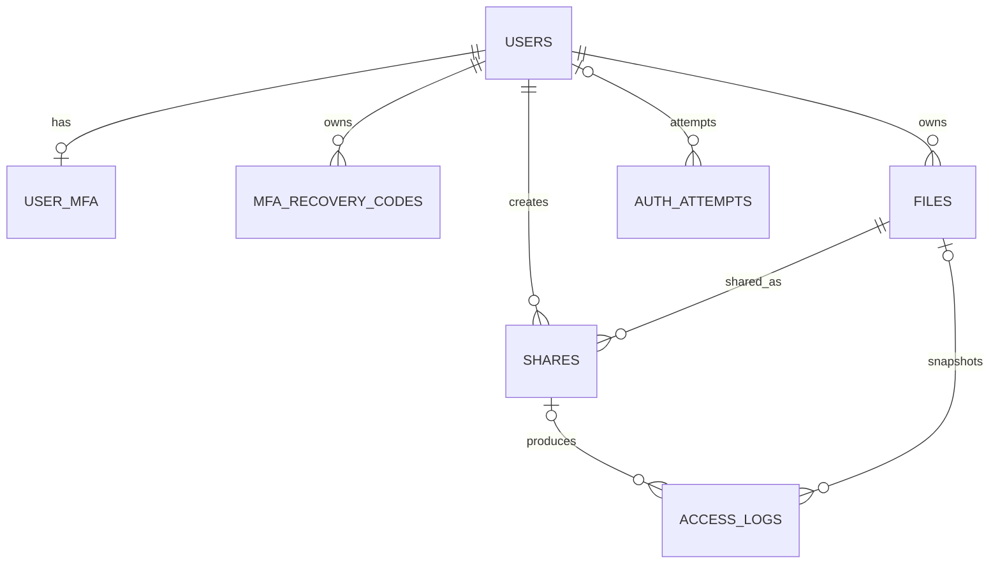

# データベース物理設計

## 1. 共通方針

- MySQL 8、InnoDB、`utf8mb4`、`utf8mb4_0900_ai_ci` を使用する。
- 主キーは `BIGINT UNSIGNED AUTO_INCREMENT`。
- 日時は `DATETIME(6)` の UTC。PHP から明示的に設定する。
- メール検索用値は小文字化・前後空白除去した `email_normalized` を使用する。
- token、TOTP秘密、復旧コードの平文は保存しない。TOTP秘密のみ復号が必要なため暗号化する。

## 2. ER図

## 3. テーブル

### `schema_migrations`

| 列 | 型 | 制約 |
|---|---|---|
| version | VARCHAR(64) | PK |
| applied_at | DATETIME(6) | NOT NULL |

### `users`

| 列 | 型 | 制約・用途 |
|---|---|---|
| id | BIGINT UNSIGNED | PK |
| email | VARCHAR(254) | NOT NULL、表示用 |
| email_normalized | VARCHAR(254) | NOT NULL、UNIQUE |
| password_hash | VARCHAR(255) | NOT NULL |
| role | ENUM('admin','user') | NOT NULL、Phase 1 は admin |
| status | ENUM('active','disabled') | NOT NULL |
| last_login_at | DATETIME(6) | NULL |
| created_at / updated_at | DATETIME(6) | NOT NULL |

容量計算時はこの行を `FOR UPDATE` でロックし、ユーザー単位の直列化キーとして使用する。

### `user_mfa`

| 列 | 型 | 制約・用途 |
|---|---|---|
| user_id | BIGINT UNSIGNED | PK、FK users ON DELETE CASCADE |
| secret_ciphertext | VARBINARY(512) | NOT NULL、nonce/tagを含む暗号文 |
| enabled_at | DATETIME(6) | NOT NULL |
| last_accepted_step | BIGINT UNSIGNED | NULL、同一TOTPの再利用防止 |
| created_at / updated_at | DATETIME(6) | NOT NULL |

### `mfa_recovery_codes`

| 列 | 型 | 制約・用途 |
|---|---|---|
| id | BIGINT UNSIGNED | PK |
| user_id | BIGINT UNSIGNED | FK users ON DELETE CASCADE、INDEX |
| code_hash | VARCHAR(255) | NOT NULL |
| used_at | DATETIME(6) | NULL |
| created_at | DATETIME(6) | NOT NULL |

### `files`

| 列 | 型 | 制約・用途 |
|---|---|---|
| id | BIGINT UNSIGNED | PK |
| owner_id | BIGINT UNSIGNED | FK users ON DELETE RESTRICT、INDEX |
| original_name | VARCHAR(255) | NOT NULL |
| storage_key | CHAR(64) ASCII | NOT NULL、UNIQUE、ランダム32 bytes hex |
| extension | VARCHAR(8) ASCII | NOT NULL |
| mime_type | VARCHAR(127) ASCII | NOT NULL |
| size_bytes | BIGINT UNSIGNED | NOT NULL |
| sha256 | BINARY(32) | NOT NULL |
| previewable | BOOLEAN | NOT NULL |
| created_at / updated_at | DATETIME(6) | NOT NULL |

索引は `(owner_id, created_at, id)` と `(owner_id, original_name)`。検索は escaped `LIKE '%term%'` を使う。

### `shares`

| 列 | 型 | 制約・用途 |
|---|---|---|
| id | BIGINT UNSIGNED | PK |
| file_id | BIGINT UNSIGNED | FK files ON DELETE CASCADE、INDEX |
| created_by | BIGINT UNSIGNED | FK users ON DELETE RESTRICT |
| token_hash | BINARY(32) | NOT NULL、UNIQUE |
| password_hash | VARCHAR(255) | NULL |
| expires_at | DATETIME(6) | NOT NULL、INDEX |
| download_limit | TINYINT UNSIGNED | NULL=無制限、CHECK IN (1,3,5) |
| download_count | INT UNSIGNED | NOT NULL DEFAULT 0 |
| revoked_at | DATETIME(6) | NULL |
| created_at / updated_at | DATETIME(6) | NOT NULL |

有効条件は `revoked_at IS NULL AND expires_at > now AND (download_limit IS NULL OR download_count < download_limit)`。

### `access_logs`

| 列 | 型 | 制約・用途 |
|---|---|---|
| id | BIGINT UNSIGNED | PK |
| share_id | BIGINT UNSIGNED | NULL、FK shares ON DELETE SET NULL |
| file_id | BIGINT UNSIGNED | NULL、FK files ON DELETE SET NULL |
| file_name_snapshot | VARCHAR(255) | NULL |
| action | ENUM('resolve','unlock','preview','download') | NOT NULL |
| outcome | ENUM('success','failure') | NOT NULL |
| reason_code | VARCHAR(64) ASCII | NOT NULL |
| ip_address | VARBINARY(16) | NOT NULL、IPv4もIPv6形式で格納 |
| user_agent | VARCHAR(512) | NULL |
| created_at | DATETIME(6) | NOT NULL |

索引は `(created_at, id)`、`(share_id, created_at)`、`(action, outcome, created_at)`。180日経過後にCLIで削除する。

### `auth_attempts`

| 列 | 型 | 制約・用途 |
|---|---|---|
| id | BIGINT UNSIGNED | PK |
| user_id | BIGINT UNSIGNED | NULL、FK users ON DELETE SET NULL |
| email_fingerprint | BINARY(32) | NOT NULL、正規化メールのHMAC |
| ip_address | VARBINARY(16) | NOT NULL |
| outcome | ENUM('success','failure','blocked') | NOT NULL |
| attempted_at | DATETIME(6) | NOT NULL |

索引は `(email_fingerprint, attempted_at)`、`(ip_address, attempted_at)`。生の未登録メールは保持しない。

## 4. トランザクション境界

- アップロード: user lock、容量再計算、実体確定、files insertを一単位とし、失敗時は実体を補償削除する。
- 復旧コード: 対象行 lock、hash 検証、`used_at` 更新を一単位とする。
- ダウンロード: share lock、状態検証、回数更新、履歴 insertを一単位とする。
- 共有停止: share lock、`revoked_at` 更新を一単位とする。
- 物理ファイルとDBは同一トランザクションにできないため、rename と補償処理で不整合を回復可能にする。

