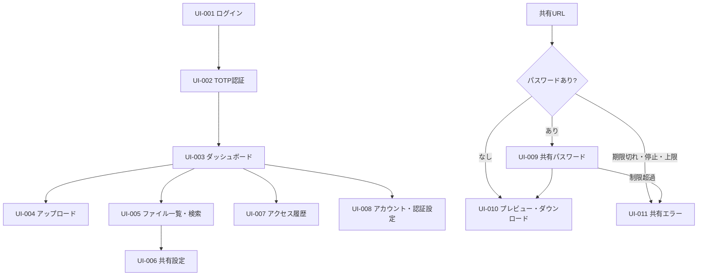

# 画面詳細設計

## 1. 画面遷移

未認証で管理画面へアクセスした場合は UI-001、MFA 待ちなら UI-002 へ遷移する。完全認証済みで UI-001/UI-002 を開いた場合は UI-003 へ遷移する。

## 2. 共通UI

- PC は左ナビゲーション、スマートフォン（767px 以下）は上部バーとドロワーを使用する。
- 主要操作はキーボード操作可能とし、フォーカスリングを消さない。
- 入力エラーは項目直下とページ上部の要約に表示し、`aria-describedby` で関連付ける。
- 破壊操作は確認ダイアログを使用する。ファイル名と結果を明示し、既定フォーカスをキャンセルへ置く。
- 日時は利用者のローカルタイム、容量は IEC 単位（KiB/MiB/GiB）で表示する。
- API の `request_id` を予期しないエラー画面に表示し、秘密情報は表示しない。

## 3. 各画面

| ID | 主な表示・入力 | 操作と状態 |
|---|---|---|
| UI-001 | メールアドレス、パスワード | 送信中は二重送信を防止。資格情報不正と存在しないアカウントは同じ文言。制限中は再試行可能時刻を表示しない。 |
| UI-002 | 6桁TOTP、復旧コードへの切替 | TOTPは数字6桁。復旧コードは空白・ハイフンを正規化。5分失効時はログインへ戻す。 |
| UI-003 | 使用量、ファイル数、有効共有数、最近の履歴 | 使用量バー、アップロード導線、最近5件のアクセス。 |
| UI-004 | ファイル選択、ドラッグ&ドロップ、検証結果 | 1ファイルずつ送信。20 MiB超過は送信前にも警告するが、最終判断はAPI。成功後は一覧へ遷移。 |
| UI-005 | 名前検索、ページング、一覧 | ファイル名、容量、形式、登録日時、有効共有数。共有、削除、対応形式のみプレビュー操作。 |
| UI-006 | 期限、パスワード、回数上限 | 発行成功時だけ完全なURLを表示し、コピー結果を通知。既存共有は期限・回数・状態だけ表示し、URLは再表示しない。 |
| UI-007 | 期間、操作、成否フィルター、履歴表 | 日時、操作、成否、理由、IP、対象ファイル名スナップショット。既定は新しい順。 |
| UI-008 | メール、MFA状態、復旧コード残数 | Phase 1ではメール変更不可。復旧コード再生成はパスワードと現在のTOTPを再確認し、旧コードを無効化。 |
| UI-009 | 共有ファイル名、共有パスワード | 失敗理由を詳細化せず再入力を促す。試行制限時は UI-011。 |
| UI-010 | ファイル名、サイズ、期限、残り回数、プレビュー、ダウンロード | JPEG/PNG/WebP/PDF/TXTのみプレビュー。ZIP/DOCX/XLSXは「プレビュー非対応」。 |
| UI-011 | 利用不可の一般メッセージ | `expired`、`revoked`、`limit_reached`、`not_found` は攻撃者へ状態を明かしすぎない共通表現とし、正規利用者向けの対処を示す。 |

## 4. 空・読込・失敗状態

- 一覧には skeleton、空状態、再試行可能エラーを用意する。
- アップロード進行中の画面離脱は確認する。失敗時は選択ファイルを保持し、原因と上限を表示する。
- セッション失効は保存していない入力がある場合もログインへ戻し、再認証後の自動再送信はしない。
- public preview の blob URL は画面離脱時に `URL.revokeObjectURL()` する。

